# win-mcp-pro

**Local computer use for Windows, through MCP.**


[](LICENSE)

Give your MCP client access to Windows controls, not just screenshots. win-mcp-pro reads the accessibility tree and finds controls by name or AutomationId. When a control exposes a UIA pattern, the client can use it to set a value, press a button or select an item.

Separate screenshot, mouse and keyboard tools let the client work by coordinates when an app doesn't expose useful controls; by default that input is bound to the element it intends and verified before anything is sent. Window and process tools, clipboard access, file operations and PowerShell cover tasks outside the UI too.

The server runs on your Windows PC over stdio, using your existing MCP client for reasoning. It has 75 registered tools; you choose which ones to expose.



[Install](#install) · [Connect your client](#connect-your-client) · [Tools](#tools) · [Permissions](#permissions) · [Testing](#testing)

> [!IMPORTANT]
> Start with the read-only configuration below. Starting the server without tool filters exposes every tool, including PowerShell, file writes and process termination.

## Install

You need Windows 10 or 11, Python 3.11 or newer, and Git.

Run these commands in PowerShell:

```powershell
git clone https://github.com/danzaio/win-mcp-pro.git
cd win-mcp-pro
python -m venv .venv
.\.venv\Scripts\python.exe -m pip install .
```

Use the virtual environment's interpreter directly. You don't need to run `Activate.ps1` or change your execution policy.

## Connect your client

For clients that use `mcpServers` configuration, use this read-only setup. Replace `C:\tools\win-mcp-pro` with your checkout location.

```json
{
  "mcpServers": {
    "win-mcp-pro": {
      "command": "C:\\tools\\win-mcp-pro\\.venv\\Scripts\\python.exe",
      "args": [
        "-m",
        "server.main",
        "--tools",
        "list_windows,snapshot,find,dump_tree,get_prop,get_patterns"
      ],
      "cwd": "C:\\tools\\win-mcp-pro"
    }
  }
}
```

Your client starts the server and manages its stdio connection. To check startup manually:

```powershell
.\.venv\Scripts\python.exe -m server.main --tools list_windows,snapshot,find,dump_tree,get_prop,get_patterns
```

The process waits for MCP requests. Logs go to stderr; stdout is reserved for the protocol.

### Working with a window

Start with `list_windows` to identify the application. Use `snapshot` to inspect its controls, then `find` to resolve the control you need. The returned ID works with `get_prop`, `get_patterns` and the action tools.

For example, this `tools/call` request finds an edit control whose AutomationId is `SearchBox`:

```json
{
  "name": "find",
  "arguments": {
    "automation_id": "SearchBox",
    "kind": "Edit"
  }
}
```

Check the returned control's handle and process ID before acting. For repeated snapshots of the same window, use `mode="full"` with its root ID; `mode="fast"` follows the foreground window.

The starter configuration doesn't allow writes or clicks. Add `set_value`, `invoke` or other action tools to `--tools` when your task needs them. After an action, read the control again to check the result.

## Tools

There are 75 registered tools across 14 modules. Your MCP client receives their argument schemas through `tools/list`.

| Group | Tools |
| --- | --- |
| Inspect the UI | `list_windows`, `snapshot`, `find`, `dump_tree`, `get_prop`, `get_patterns`, `table_extract` |
| Control patterns | `invoke`, `toggle`, `select`, `expand`, `scroll_into_view`, `focus`, `set_value`, `get_value`, `paste_text`, `menu_click`, `form_fill`, `choose_file` |
| Input and clipboard | `click`, `double_click`, `cursor_position`, `move`, `scroll`, `shortcut`, `clipboard_get`, `clipboard_set` |
| Wait for a state | `wait`, `wait_text`, `wait_focus`, `wait_enabled`, `wait_gone`, `wait_change` |
| Windows and processes | `app_launch`, `code_goto`, `win_move`, `win_resize`, `win_min`, `win_max`, `win_restore`, `win_snap`, `win_close`, `win_topmost`, `get_hwnd_pid_path`, `proc_tree`, `is_elevated`, `integrity_level`, `exclude_proc`, `kill_proc` |
| System | `powershell`, `fs_list`, `fs_read`, `fs_write`, `registry_get`, `notify`, `scrape_dom`* |
| Transaction helpers | `preview`, `dry_run`, `before_after`, `profile` |
| Images | `screenshot`, `zoom`, `displays`, `img_convert` |
| OCR | `ocr_read`, `ocr_click` |
| Browser (isolated) | `browser_open`, `browser_status`, `browser_snapshot`, `browser_click`, `browser_fill`, `browser_read`, `browser_close` |
| Replay and diagnostics | `replay`, `doctor` |

\* `scrape_dom` has no shipped browser backend and returns `NO_DOM_BACKEND` unless one is supplied separately.

To inspect the registry from the terminal:

```powershell
.\.venv\Scripts\python.exe -c "import tools; tools.load_all_modules(); print(sorted(tools.names()))"
```

## Permissions

Use `--tools` as an allowlist. `--exclude-tools` removes named tools and wins if a name appears in both lists. An explicitly empty filter is rejected; omitting both flags enables all registered tools.

These filters restrict which MCP tools a client can call. They are not an operating-system sandbox. PowerShell runs with the server process's permissions, and enabled UI tools can act on other applications.

Some tools accept `confirm=True`. That is an argument the caller can supply, not a human approval dialog. The transaction helpers don't gate direct UIA, input or system calls either; invoking `preview` does not authorize or protect a later action.

Run unelevated unless the target application requires elevation. Windows privilege boundaries can prevent interaction with elevated windows.

### Input binding

Input tools are bound to the element they intend by default. `click` with x/y requires the `frame` id from a fresh `screenshot`/`zoom` (x/y are then image pixels of that capture) plus the `target` element id. Before one event is sent the server translates the point to desktop coordinates, checks it is inside the target's rectangle, hit-tests the window under it, and checks the target's integrity level; any mismatch comes back as a typed error (`FRAME_STALE`, `TARGET_MISMATCH`, `OCCLUDED`, `ELEVATION_REQUIRED`, ...) and no input is sent. `shortcut` requires a target whose window is brought to the foreground first when needed; `scroll` and drags are bound the same way. Start the server with `--input-unrestricted` to restore the legacy global input (raw coordinates and unbound keys) for scripts that need it.

The server sets per-monitor DPI awareness at startup so UIA rectangles, captures and input share one physical-pixel space. Captures report a short-lived frame id and their display origin; absolute input spans the full virtual desktop, including monitors with negative coordinates.

### Isolated tree walks (worker mode)

`--uia-worker` runs `snapshot`, `find` and `dump_tree` in a supervised child process. A walk that does not answer within `--worker-timeout-ms` (default 15000 ms) gets the child killed and comes back as a typed `WORKER_TIMEOUT`; the session stays alive and the next call starts a fresh worker. Repeated failures hit a crash-loop guard (`WORKER_UNAVAILABLE`). Walks are read-only, so a timeout means "result unknown, zero side effects" and nothing is retried automatically; a worker that dies mid-call answers `WORKER_LOST`. Killed workers exit on stdin EOF, so none is orphaned. Element ids that carry native identity (`hwnd:runtimeid`) keep resolving after a kill; digest-only ids from a dead worker may not. Input and single-element resolution stay in the server process, so a killed worker can never abandon a half-sent gesture.

The server writes JSONL invocation metadata to stderr: tool names, argument field names and success or error events. It does not keep a durable action history or verify UI effects on your behalf.

### Browser (isolated session)

`browser_open`, `browser_snapshot`, `browser_click`, `browser_fill`, `browser_read`, `browser_status` and `browser_close` drive a Chromium browser (Edge or Chrome, whichever is installed) through the DevTools protocol. The browser starts with a throwaway profile under the temp directory - it never touches your own browser session, cookies or logins. Clicks are dispatched inside the browser at the element's box center (no OS-level mouse input), and refs are validated before acting: an unknown ref refuses, and a node that disappeared refuses as `STALE_REF` instead of clicking somewhere else. First launch is headless by default (`browser_open(headless=false)` shows the window); `WINMCP_BROWSER_PATH` overrides the browser binary. `browser_open` and `browser_status` report the browser process id, so the same window can also be found through `list_windows`/`find` and addressed from both surfaces.

## Compatibility

UI inspection depends on the application's UI Automation provider. Standard accessible controls are the intended target. Custom canvases, games and some Electron interfaces may expose little useful data.

`screenshot` and `zoom` save PNG files and return their paths. When the PNG fits the inline cap (4 MB), the same bytes also ride back as an MCP image content block; over the cap the result keeps the path only, with a reason. Each capture reports its display origin and a short-lived frame id: input tools accept `frame=...` so a click follows a fresh look, and a stale frame is refused instead of clicking at old pixels. When the tree has no text at all, `ocr_read` recognizes text from pixels (Windows OCR) and returns per-line/per-word boxes plus the same kind of frame, so a word can be clicked through the frame-pinned path. The server doesn't automatically switch to screenshots when UIA cannot find a control.

Snapshot caching is used only when the installed UIA library and control support it. Otherwise the tree is read directly. Time budgets are checked between UIA calls; they cannot interrupt a blocked COM call. `find` and `dump_tree` have depth and node limits, not hard wall-clock deadlines.

`exclude_proc` skips matching executable names in full-mode snapshot traversal, including explicit roots. Process-name lookup is best-effort, so exclusions are a traversal aid, not an access-control boundary.

Browser automation runs in an isolated session with a disposable profile (see the `browser_*` tools); it never attaches to your own browser profile. A network transport is not included: this package serves a local MCP client over stdio.

## Testing

Install the development extra and run the unit and offline runner tests:

```powershell
.\.venv\Scripts\python.exe -m pip install -e ".[dev]"
.\.venv\Scripts\python.exe -m pytest tests eval/test_smoke.py -q
```

The local validation on 12 October 2026 passed **517 tests** (unit suite plus eval smoke), with the opt-in live tests skipped in that run; all four live files were run separately and passed. A built wheel was also installed in a clean environment and checked through a real MCP stdio connection. `docs/parity.md` maps each advertised capability to the test or bench task that proves it.

The UIA live test creates its own disposable WinForms window. It checks scoped snapshots, value writes and button invocation with fresh readback, then closes its own processes. It is not a claim that every Windows application has been tested.

To run it:

```powershell
$env:WINMCP_RUN_LIVE_UIA = "1"
try {
    .\.venv\Scripts\python.exe -m pytest tests/test_live_uia.py -q
} finally {
    $env:WINMCP_RUN_LIVE_UIA = $null
}
```

The click-binding live test creates its own window, takes a frame of it and
clicks its button through the frame-pinned path; it asserts the effect from
the fixture's own title and restores the cursor afterwards:

```powershell
$env:WINMCP_RUN_LIVE_CLICK = "1"
try {
    .\.venv\Scripts\python.exe -m pytest tests/test_live_click_binding.py -q
} finally {
    $env:WINMCP_RUN_LIVE_CLICK = $null
}
```

The browser live test launches the installed Edge/Chrome headless with a
disposable profile, drives a `data:` page through the MCP route and asserts
the click effect from the page itself:

```powershell
$env:WINMCP_RUN_LIVE_BROWSER = "1"
try {
    .\.venv\Scripts\python.exe -m pytest tests/test_live_browser.py -q
} finally {
    $env:WINMCP_RUN_LIVE_BROWSER = $null
}
```

The OCR live test runs the real Windows OCR engine over a synthetic image
(no desktop capture):

```powershell
$env:WINMCP_RUN_LIVE_OCR = "1"
try {
    .\.venv\Scripts\python.exe -m pytest tests/test_live_ocr.py -q
} finally {
    $env:WINMCP_RUN_LIVE_OCR = $null
}
```

The 12-task eval uses `FakeClient` fixtures. It checks the runner and its expectations, not live desktop performance:

```powershell
.\.venv\Scripts\python.exe eval/run.py --min-success 0.8 --out "$env:TEMP\win-mcp-pro-eval.json"
```

The bench matrix drives two WinForms fixtures and a Tk fixture (no UIA tree) with an external oracle: every effect is asserted from the fixtures' own JSONL logs, and a decoy fixture proves zero wrong-target leakage. It runs 13 driver-conformance tasks and writes `bench/results/`:

```powershell
.\.venv\Scripts\python.exe bench/run_matrix.py
```

See `bench/README.md` for scope, limits and what the first run caught (four real API mismatches, each now fixed with a regression test).

The [CI workflow](.github/workflows/eval-gate.yml) runs the Windows unit suite and offline eval checks. It does not run the opt-in live UIA test. See [GitHub Actions](https://github.com/danzaio/win-mcp-pro/actions/workflows/eval-gate.yml) for recent runs.

## Documentation

- [Operations guide](docs/SOP.md): configuration, troubleshooting and deployment notes.
- [Parity and evidence](docs/parity.md): what each capability claim is proven by.
- [Terminal demo](demo/script.md): commands for a short walkthrough.
- [Tool implementations](tools): schemas and handlers for each tool group.

## License

[MIT](LICENSE).
