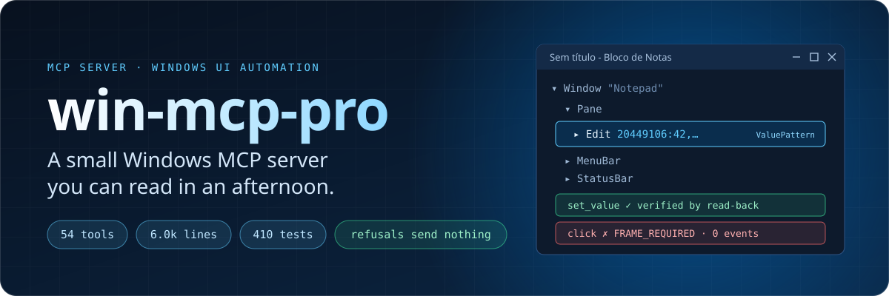
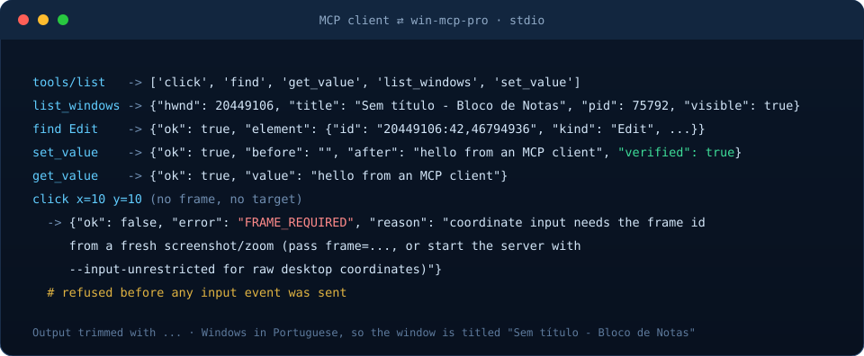
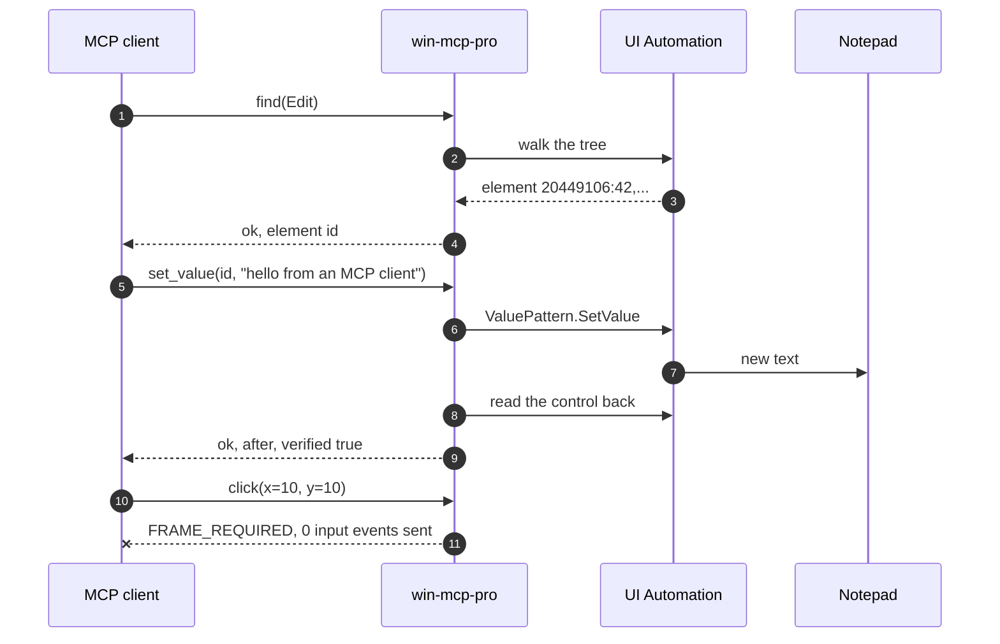
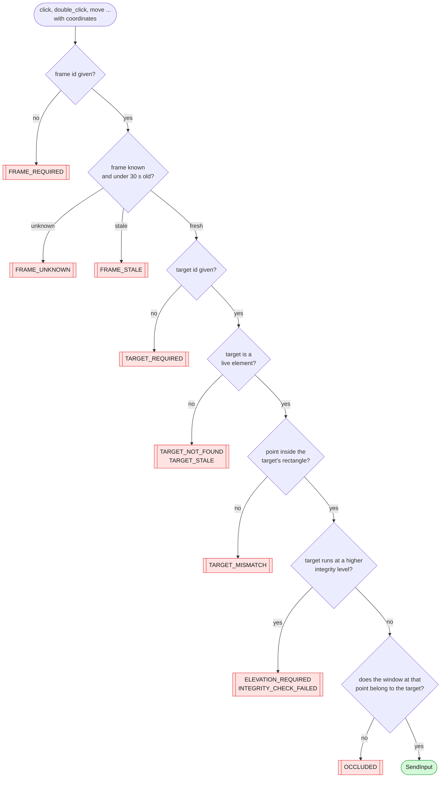
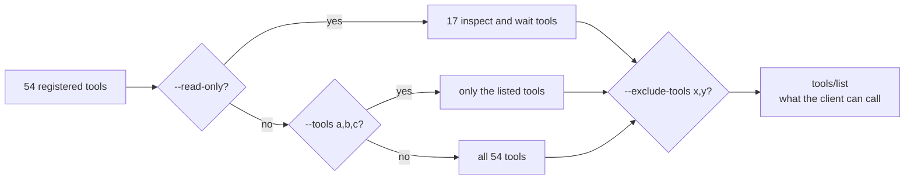
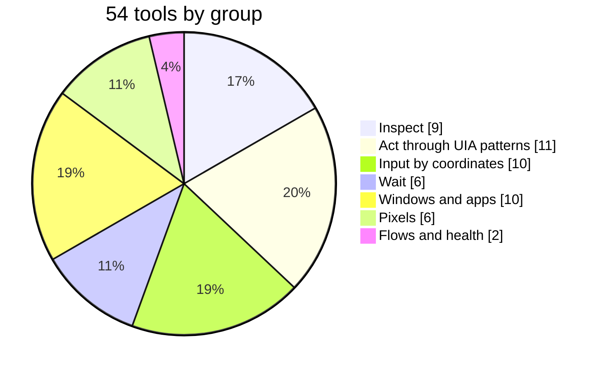
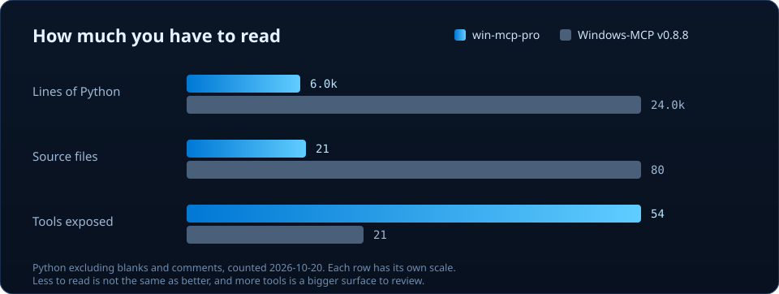
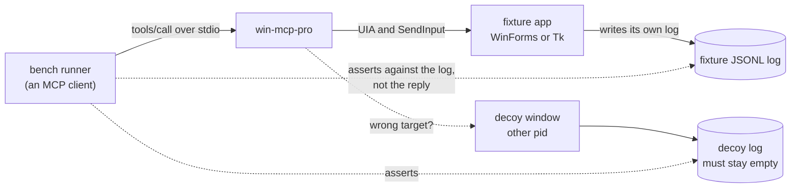

<p align="center">
  
</p>

<p align="center">
  <a href="https://github.com/danzaio/win-mcp-pro/actions/workflows/ci.yml"></a>
  
  
  <a href="LICENSE"></a>
</p>

<p align="center">
  <a href="#quick-start">Quick start</a> ·
  <a href="#see-it-work">Demo</a> ·
  <a href="#how-a-click-is-checked">The gate</a> ·
  <a href="#safety-model">Safety</a> ·
  <a href="#tools">Tools</a> ·
  <a href="#proof">Proof</a> ·
  <a href="#limits">Limits</a>
</p>

**An MCP server that lets an agent drive Windows apps through UI Automation,
and refuses to act on anything it has not verified.** It can act as you, so it
is built to be read before you trust it.

| Small | Bound | Provable |
| --- | --- | --- |
| 6.0k lines of Python in 21 files. Read it in an afternoon. | Every coordinate input is tied to a fresh capture and the element it targets. A failed check sends nothing. | A bench drives disposable windows and checks each effect in the app's own log, not in the server's reply. |

## Quick start

Read-only first. This exposes inspection and waiting only: no clicks, no
typing, no clipboard, no files.

```powershell
uvx --from git+https://github.com/danzaio/win-mcp-pro win-mcp-pro --read-only
```

Needs Windows 10 or 11 and [uv](https://docs.astral.sh/uv/). Python 3.11 or
newer is enough; uv fetches it if you do not have it.

**Claude Code**

```powershell
claude mcp add win-mcp-pro -- uvx --from git+https://github.com/danzaio/win-mcp-pro win-mcp-pro --read-only
```

**Claude Desktop, Cursor, or any stdio client**: add this to the client's MCP
config (Claude Desktop: `%APPDATA%\Claude\claude_desktop_config.json`).

```json
{
  "mcpServers": {
    "win-mcp-pro": {
      "command": "uvx",
      "args": ["--from", "git+https://github.com/danzaio/win-mcp-pro", "win-mcp-pro", "--read-only"]
    }
  }
}
```

To let the client act, replace `--read-only` with an explicit list, for example
`--tools list_windows,find,get_value,set_value,invoke`.

## See it work

<p align="center">
  
</p>

A real session against Notepad, driven by an MCP client. Output is trimmed with
`...`; nothing else is changed. `set_value` reads the control back and says
whether it took. The blind `click` is refused before any event is sent.

<details>
<summary>Plain-text transcript</summary>

```text
tools/list   -> ['click', 'find', 'get_value', 'list_windows', 'set_value']
list_windows -> {"hwnd": 20449106, "title": "Sem título - Bloco de Notas", "pid": 75792, "visible": true}
find Edit    -> {"ok": true, "element": {"id": "20449106:42,46794936", "kind": "Edit", ...}}
set_value    -> {"ok": true, "before": "", "after": "hello from an MCP client", "verified": true}
get_value    -> {"ok": true, "value": "hello from an MCP client"}
click x=10 y=10 with no frame or target ->
  {"ok": false, "error": "FRAME_REQUIRED", "reason": "coordinate input needs the frame id
   from a fresh screenshot/zoom (pass frame=..., or start the server with
   --input-unrestricted for raw desktop coordinates)"}
```

The machine runs Windows in Portuguese, so the window is titled
`Sem título - Bloco de Notas`.

</details>

## How it works


A typical flow is `list_windows`, then `snapshot` or `find`, then an action,
then read the control again to confirm. The client asks for things by element
id. The server answers with what it observed, not with what it hoped happened.



## How a click is checked

Coordinates are the fallback, not the default, so they get the strictest
treatment. A coordinate click has to pass every gate below. Any failure returns
a typed error **before** a single input event is sent.



- A call that names only a target clicks its center, and still goes through the
  live-element, elevation and occlusion checks.
- Anything the caller provides is verified, even on a plain `move`.
- `--input-unrestricted` turns the coordinate checks off. It is off by default.
- `tests/test_input_binding.py` proves each refusal with a spy on `SendInput`.

## Safety model

What a client can see is decided before any call arrives. Filtered-out tools are
absent from `tools/list` and answer `UNKNOWN_TOOL` if called anyway.



| Flag | Effect |
| --- | --- |
| `--read-only` | Inspection and waiting only (17 tools). Cannot be combined with `--tools`. |
| `--tools a,b,c` | Only these tools exist for the client. |
| `--exclude-tools x,y` | Everything except these. Wins over `--tools`. |
| `--input-unrestricted` | Allow raw coordinates and unbound keys. Off by default. |
| `--uia-worker` | Run tree walks in a child process that is killed on a stuck call. |

An empty list is rejected rather than read as "allow everything".

**This is a policy, not a sandbox.** An allowed tool runs with your
permissions. `confirm=True` on a tool is an argument the client supplies, not
a human approval prompt. See [SECURITY.md](SECURITY.md).

Logs go to stderr as JSON lines: tool names and argument names, never values.

## Tools

54 tools. Your client gets each schema from `tools/list`.



| Group | Tools |
| --- | --- |
| Inspect | `list_windows` `get_active_window` `snapshot` `find` `dump_tree` `get_prop` `get_patterns` `get_value` `table_extract` |
| Act through UIA patterns | `invoke` `toggle` `select` `expand` `scroll_into_view` `focus` `set_value` `paste_text` `menu_click` `form_fill` `choose_file` |
| Input by coordinates | `click` `double_click` `move` `scroll` `shortcut` `type_text` `key_hold` `cursor_position` `clipboard_get` `clipboard_set` |
| Wait | `wait` `wait_text` `wait_focus` `wait_enabled` `wait_gone` `wait_change` |
| Windows and apps | `app_launch` `open_default` `win_move` `win_resize` `win_min` `win_max` `win_restore` `win_snap` `win_close` `exclude_proc` |
| Pixels | `screenshot` `zoom` `win_shot` `displays` `ocr_read` `ocr_click` |
| Flows and health | `replay` `doctor` |

**UIA patterns before pixels.** The client reads the accessibility tree and
uses `invoke`, `set_value` and friends. Coordinates are the fallback, and they
must be tied to a fresh capture and the element they intend. `replay` re-runs a
recorded flow and stops at the first step whose result differs (`DRIFT`).

## Why another one

<p align="center">
  
</p>

The most-used Windows MCP server,
[CursorTouch/Windows-MCP](https://github.com/CursorTouch/Windows-MCP), is about
24k lines of Python and needs Python 3.14+. This one aims to be small enough to
read before you let it drive your desktop, and runs on 3.11+.

Source size is lines of Python excluding blanks and comments, counted on
2026-10-20. It is a measure of how much you have to read, not of quality.
This one has **more** tools, not fewer: most are small and single-purpose, and
that is a larger surface to review. It is why `--read-only` and `--tools`
exist. Windows-MCP is the more widely used project and has features this one
does not, including a desktop overlay and HTTP transports.

## Proof

The unit suite runs against fakes (410 tests), so it never touches your
desktop. CI builds the wheel on Windows, installs it in a clean environment and
starts it. On top of that, `bench/run_matrix.py` is a driver-conformance matrix
with an outside witness: it checks each effect in the fixture's own log, never
in the server's reply.



28 tasks cover identity lookup, `set_value` with read-back, `invoke`,
frame-pinned clicks, refusals, wrong-target leakage, OCR, replay, a real Open
dialog, and a stepped drag. The first full run failed 6 of 11 and exposed four
real bugs, each fixed with a regression test. Details and honest scope are in
[bench/README.md](bench/README.md).

## Limits

- It only sees what an app exposes through UI Automation. Games, canvases and
  some Electron or custom-drawn UIs expose little. `ocr_read` reads pixels as a
  fallback; the server never switches to screenshots on its own.
- An unelevated server cannot send input to an elevated window (Windows UIPI).
  It reports `ELEVATION_REQUIRED`. Run it unelevated unless you must.
- Time budgets are checked between UIA calls. They cannot interrupt a COM call
  that is already blocked; `--uia-worker` exists for that.
- stdio only, one local client. No network transport.
- Tested on Windows 10 Pro (build 19045) with Notepad and disposable WinForms
  and Tk fixtures. Windows 11 is supported by the API but untested by me. That
  is not a claim that every application works.

<details>
<summary>Troubleshooting</summary>

- **A tool is missing in the client.** Check `--tools`, `--exclude-tools` and
  `--read-only` first, then list what is registered:
  `python -c "from win_mcp_pro import tools; tools.load_all_modules(); print(sorted(tools.names()))"`
- **The client says the server died right after start.** Something wrote to
  stdout, which is the protocol channel. Logs belong on stderr.
- **`find` returns `NOT_FOUND` for something you can see.** The app probably
  has no UI Automation provider. Check with Inspect.exe from the Windows SDK or
  Accessibility Insights before blaming the query.
- **`ELEVATION_REQUIRED`.** The target runs elevated and the server does not.
  Restart the server elevated, or pick another target.

</details>

## Repo map

```text
win-mcp-pro/
├── win_mcp_pro/
│   ├── server/        MCP wiring: CLI, tool registry and filter, UIPI check,
│   │                  --uia-worker supervisor, stderr audit log
│   └── tools/         one module per area, each exposes TOOLS
│       ├── compat.py      coordinate input, clipboard, and the gate every click passes
│       ├── patterns.py    invoke, toggle, select, expand, focus, scroll_into_view
│       ├── query.py       find, dump_tree, get_prop, get_patterns
│       ├── snapshot.py    snapshot
│       ├── values.py      get_value, set_value, paste_text, menu_click, form_fill, ...
│       ├── waits.py       the wait_* family
│       ├── winproc.py     windows, processes, app launch
│       ├── vision.py      screenshot, zoom, win_shot, displays, capture frames
│       ├── ocr.py         ocr_read, ocr_click
│       ├── replay.py      re-run a recorded flow, stop at the first DRIFT
│       └── doctor.py      environment check
├── tests/             410 tests against fakes; never touch your desktop
├── bench/             28-task conformance matrix with an external oracle
├── docs/diagrams/     the images used in this README
└── .github/           CI, publish workflow, issue and PR templates
```

## Develop

```powershell
git clone https://github.com/danzaio/win-mcp-pro.git
cd win-mcp-pro
python -m venv .venv
.venv\Scripts\python.exe -m pip install -e ".[dev]"
.venv\Scripts\python.exe -m pytest -q
```

The bench does touch your desktop and moves your cursor: run it on an idle
machine.

```powershell
.venv\Scripts\python.exe bench\run_matrix.py
```

See [CONTRIBUTING.md](CONTRIBUTING.md), [SECURITY.md](SECURITY.md) and
[CHANGELOG.md](CHANGELOG.md). Licensed under [MIT](LICENSE).
