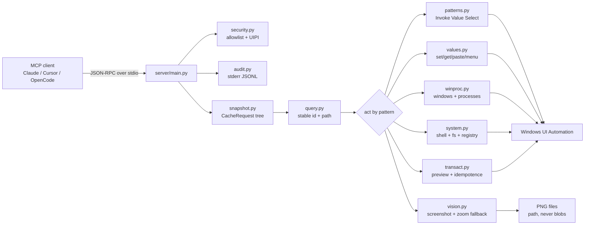

# win-mcp-pro


A Windows computer-use MCP server that reads the UI as a **tree**, not a picture. It finds controls by name and AutomationId, acts through Control Patterns, and writes an audit row for every call. Screenshots exist only as an opt-in fallback.

> **Status: v1 complete.** 365 tests green across 10 tool modules, plus a
> golden-set eval gate and a failure museum that pins every known bad case.
> `server/registry.py` and `tools.load_all_modules()` are the source of truth
> at runtime (53 tools). Numbers marked `PENDING-RUN` are honest placeholders
> for live measurements, not results. Nothing below is invented.

---

## 1. The problem

Most Windows computer-use agents take a screenshot, ask a vision model where the button is, then click those coordinates. It demos well and falls apart on a real desktop.

- **Cost.** A screenshot pushes the entire desktop into the model context on every single step. The tree pushes the few hundred elements that actually matter.
- **Drift.** Coordinates go stale. A window moves, a toast pops over the button, an animation finishes, and the click lands on nothing.
- **No audit trail.** "Clicked (1042, 388)" is not a fact you can review two weeks later. "Invoked the Save button in Notepad's File menu" is.

Windows has had the answer since Vista: UI Automation. Every standard control reports a name, an AutomationId, a control type, and a set of Control Patterns. That is the same data a screen reader consumes, which is why it is stable, typed, and pure text.

win-mcp-pro automates against that tree: **snapshot once, resolve a stable id, act by pattern.** Image is the fallback, never the default.

## 2. Architecture



```
 MCP client (Claude Desktop / Cursor / OpenCode)
      |
      |  JSON-RPC 2.0 over stdio.  Logs go to stderr only.
      v
 +--------------------------------------------------------------------+
 | win-mcp-pro    (python -m server.main)                              |
 |                                                                    |
 |  --tools a,b,c  /  --exclude-tools x,y  ->  security.py (allowlist)  |
 |  every tool call                        ->  audit.py   (stderr JSONL)|
 |                                                                    |
 |    1 SNAPSHOT            2 FIND                3 ACT                |
 |    one CacheRequest  ->  stable id + path ->  Control Pattern call   |
 |    tree, props,         from the window      (Invoke, Value,         |
 |    patterns             down to the child    Selection, Expand,      |
 |                                             Window, Scroll, Text)   |
 |                                                                    |
 |    tools/snapshot.py    tools/query.py     tools/patterns.py        |
 |                                          tools/values.py            |
 |                                          tools/compat.py (opt-in)   |
 |                                          tools/waits.py             |
 |                                          tools/transact.py          |
 |                                          tools/winproc.py            |
 |                                          tools/system.py             |
 |                                          tools/vision.py (fallback)  |
 +--------------------------------------------------------------------+
      |
      v
 Windows UI Automation  (uiautomation + comtypes)
 Notepad | Calc | Explorer | Settings | Chrome/Edge via DOM
```

Three rules hold the design together:

1. **Snapshot is batched.** One `CacheRequest` pulls properties, patterns, and the subtree scope in a single traversal instead of one round-trip per property.
2. **Find returns an id and a path.** The path is `window -> parent -> child`, searched one level at a time. There is no depth-3-from-the-root search.
3. **Act uses patterns, not pixels.** `invoke` calls InvokePattern. It never moves the mouse to a rectangle. The four compat tools (`click`, `move`, `scroll`, `shortcut`) are the deliberate escape hatch and are off by default in the recommended allowlist.

### Tools

Eight groups. The design names the tools below; `tools.load_all_modules()` reports **53 registered today**. A module exposes `TOOLS` with a pydantic v2 `schema` per tool, and the registry picks modules up by filename at startup, so a new `tools/<group>.py` needs no wiring. Check the live list before trusting this table:

```
.venv\Scripts\python -c "import tools; tools.load_all_modules(); print(len(tools.names()))"
```

Two results from that command look like a broken repo and are not. `ImportError: cannot import name 'Literal' from 'pydantic'` means one landed module has a bad import, and because `load_all_modules()` is all-or-nothing, one bad module loads nothing at all. A bare `0` with no error means nothing called `load_all_modules()`, so the server would start and expose no tools. Both are worth catching here rather than in a client.

| Group | Tools |
| --- | --- |
| Tree | `list_windows`, `snapshot`, `find`, `dump_tree`, `get_prop`, `get_patterns` |
| Act by pattern | `invoke`, `toggle`, `select`, `expand`, `scroll_into_view`, `focus`, `set_value`, `get_value`, `paste_text`, `menu_click` |
| Compat (opt-in) | `click`, `move`, `scroll`, `shortcut`, `clipboard_get`, `clipboard_set` |
| Waits, one call | `wait`, `wait_text`, `wait_focus`, `wait_enabled`, `wait_gone` |
| Window / process | `app_launch`, `win_move`, `win_resize`, `win_min`, `win_max`, `win_restore`, `win_snap`, `get_hwnd_pid_path`, `proc_tree`, `is_elevated`, `integrity_level`, `exclude_proc`, `kill_proc` |
| System | `powershell`, `fs_list`, `fs_read`, `fs_write`, `registry_get`, `notify`, `scrape_dom` |
| Transaction | `preview`, `dry_run`, `before_after`, `profile` |
| Vision (fallback) | `screenshot`, `zoom` |

Target apps: Notepad, Calc, Explorer, Settings, and Chrome/Edge through the DOM. Browser automation goes through `scrape_dom` and the DOM only. Clicking a web page with desktop coordinates is not supported on purpose.

## 3. Demo (90 seconds, terminal only)

Full script with exact commands and expected outputs: [`demo/script.md`](demo/script.md). No screenshots, no GUI recording. The whole demo is a terminal: tests, the eval runner, and the audit log.

## 4. Eval

Golden set of 12 tasks in `eval/tasks.json` covering Notepad, Calc, Explorer, Settings, and Chrome through the DOM. Driven by `eval/run.py`, gated in CI by `.github/workflows/eval-gate.yml`. Each task declares a goal, the tool path an agent would take, and a machine-checkable expectation. The runner reports one row per task and writes `eval/results.json` (regenerated on every run, never committed).

Reproduce with:

```
python eval/run.py                       # full golden set, prints the table
python eval/run.py --out results.json --min-success 0.8   # what CI runs
```

`--min-success` is the gate: below that success rate the command exits non-zero and the build fails.

**Read this before you trust a green table.** The runner ships with a `fake` client that replays canned answers through the real runner, checks, and table code. It proves the plumbing end to end and touches no UI. It is not a measure of automation. The numbers that matter come from a client that drives the real MCP stdio server against a live desktop, and that run has not happened yet.

| # | task | app | ok | ms | tokens_est |
| --: | --- | --- | :---: | --: | --: |
| 1 | notepad-01-launch-and-list | notepad | PENDING-RUN | PENDING-RUN | PENDING-RUN |
| 2 | notepad-02-type-and-readback | notepad | PENDING-RUN | PENDING-RUN | PENDING-RUN |
| 3 | notepad-03-save-as-dialog | notepad | PENDING-RUN | PENDING-RUN | PENDING-RUN |
| 4 | calc-01-open-app | calc | PENDING-RUN | PENDING-RUN | PENDING-RUN |
| 5 | calc-02-arithmetic-on-display | calc | PENDING-RUN | PENDING-RUN | PENDING-RUN |
| 6 | calc-03-history-panel | calc | PENDING-RUN | PENDING-RUN | PENDING-RUN |
| 7 | explorer-01-open-public-folder | explorer | PENDING-RUN | PENDING-RUN | PENDING-RUN |
| 8 | explorer-02-enter-folder-item | explorer | PENDING-RUN | PENDING-RUN | PENDING-RUN |
| 9 | settings-01-open-bluetooth-page | settings | PENDING-RUN | PENDING-RUN | PENDING-RUN |
| 10 | settings-02-toggle-wifi | settings | PENDING-RUN | PENDING-RUN | PENDING-RUN |
| 11 | chrome-dom-01-read-page-heading | chrome-dom | PENDING-RUN | PENDING-RUN | PENDING-RUN |
| 12 | chrome-dom-02-locate-submit-button | chrome-dom | PENDING-RUN | PENDING-RUN | PENDING-RUN |

Context, not our result. The published baselines are brutal for everyone: Navi scored 19.5% on WindowsAgentArena against 74.5% for a human, and the best visual grounding models sit near 40% on ScreenSpot-Pro. Those numbers come from the papers, not from this repo. This project does not compete on grounding accuracy; it removes the image from the loop entirely and accepts the narrower target set that comes with that.

## 5. Cost and latency

What gets cheaper, and why, in three moves:

- **One snapshot instead of many reads.** Caching pulls the whole relevant subtree in one traversal. A vision agent needs a fresh full-desktop image per step.
- **No coordinate retry loop.** A pattern call either works or returns a typed error. A pixel click that misses gets retried, and every retry is another image.
- **Text in, text out.** The tree is JSON, so `tokens_est` is measured per call by the eval runner instead of estimated from a screenshot.

`profile` is the tool built for that question: timing per stage plus the estimated tokens saved. Read it when you want to know where the milliseconds actually went, instead of guessing from a total.

Real figures: PENDING-RUN. The stated goal is zero images per task and roughly an order of magnitude below vision cost, measured by `tokens_est` across the golden set.

## 6. Failure modes

Each of these has a defined behavior, and the failure museum (`tests/test_failures.py`) is where they are pinned. It mocks each broken condition and asserts the contract: slow provider skipped then timed out per call, duplicate delivery producing one effect, an elevated target returning a typed error, a double submit happening exactly once, and a missing element coming back as `NOT_FOUND` with a vision hint. The behavior is the contract, not a nice-to-have.

| What goes wrong | What the server does |
| --- | --- |
| App has no UIA provider (Canvas, custom render, game) | `NOT_FOUND` with a reason and a pointer to the vision fallback. Never a coordinate guess. |
| A process makes tree traversal crawl | `exclude_proc` plus a per-call timeout. Slow provider is skipped, not hung on. |
| The same action is delivered twice | Idempotency key on `(window, element, action)`. Exactly one effect. |
| The target window is elevated and the server is not | `ELEVATION_REQUIRED`, typed, with the fix. Never a silent failure. |
| A retry after a form submit | `before_after` log proves exactly-once, so a retry cannot double-submit. |
| An element renders with no name at all | `NOT_FOUND` with the reason and the vision-fallback suggestion. |
| Anything writes to stdout | Banned by design. Logs go to stderr, because stdout is the protocol channel and one stray print kills the session. |

## 7. Install from zero

Needs Windows 10 or 11, Python 3.11 or newer, and git. Nothing else.

```
# 1. Get the code
git clone <repo-url> win-mcp-pro
cd win-mcp-pro

# 2. Isolated environment
python -m venv .venv

# 3. Install the package and its dependencies
.venv\Scripts\python -m pip install -e .

# 4. Smoke test: the package imports
.venv\Scripts\python -c "import server"

# 5. Run the suite
.venv\Scripts\python -m pytest tests -q

# 6. Start the server (stays in the foreground and speaks stdio)
.venv\Scripts\python -m server.main
```

Use the venv interpreter directly instead of `Activate.ps1`. Machines with a restricted execution policy block that script, and the resulting error reads like a broken repo.

On step 5, expect a collection error for any tool group whose module has not landed yet. That is a real gap in the build, not a broken environment, and it should be reported rather than skipped around. `python -m pytest tests/test_security.py -q` passes on its own today.

Then point an MCP client at it. Use the virtualenv interpreter, not a bare `python`, or the client will start a server with no dependencies installed:

```json
{
  "mcpServers": {
    "win-mcp-pro": {
      "command": "C:\\path\\to\\win-mcp-pro\\.venv\\Scripts\\python.exe",
      "args": ["-m", "server.main", "--exclude-tools", "click,move,scroll,shortcut"],
      "cwd": "C:\\path\\to\\win-mcp-pro"
    }
  }
}
```

### Repo layout

```
win-mcp-pro/
  server/     main.py (stdio entry)  registry.py  audit.py  security.py
  tools/      snapshot  query  patterns  values  compat
              waits  winproc  system  transact
  tests/      unit tests + the failure museum
  eval/       tasks.json  run.py  (results.json is generated, not committed)
  .github/    workflows/eval-gate.yml
  docs/       SOP.md
  demo/       script.md
```

`eval/results.json` is generated by the runner and is gitignored output, not a source of truth. Read the table the runner prints, not a stale file.

### Run as admin when you need to

UIA enumerates more when the process is elevated, and an unelevated server cannot send input to an elevated window (UIPI). Read-only inspection works either way. Start the terminal as Administrator, then run the server from it. Do not run elevated by habit; run elevated when a target window is elevated.

## 8. Tradeoffs

**The tree is a narrower world than the screen, so there is a fallback.** Anything without a UIA provider is invisible to the tree: Canvas, WebGL, games, some Electron builds. Vision-only agents (Microsoft's OmniParser and friends) pay image tokens on *every* step to cover that ground. Here the order is reversed: tree first, image only when the tree answers `NOT_FOUND`. The `screenshot` and `zoom` tools write a PNG to disk and hand back a path, never a base64 blob in context. Same coverage as pure-vision agents where it matters, a fraction of the token bill everywhere else.

**stdio keeps v1 simple and single-client.** No network surface, no auth to get wrong, one client at a time. Remote use needs Streamable HTTP with a bearer token, an IP allowlist, TLS, and OAuth PKCE. That is documented as an extension, not shipped here.

**Elevation is a real decision.** More enumeration and more reach, but running as admin is a security posture, not a config flag. The default is unelevated, and `ELEVATION_REQUIRED` tells you when to change that.

**Four compat tools are a loaded gun.** `click`, `move`, `scroll`, and `shortcut` break every rule above, on purpose, for the apps the tree cannot drive. They are the first things to switch off with `--exclude-tools`.

**The audit log is not free.** Every call writes a JSONL row to stderr. It is cheap, and it is the only reason you can answer "what did the agent do to my machine" after the fact. Turn it off and you lose that answer.

**Text selection through the tree does not work.** This is an inherited UIA limitation, not a bug to fix here. The same goes for typing into an IDE character by character: use `set_value` or `paste_text`.

**Not every tool in the table is safe.** `kill_proc`, `fs_write`, and `registry_get` touch the machine. Keep the allowlist tight, and make `preview` mandatory before anything irreversible.
